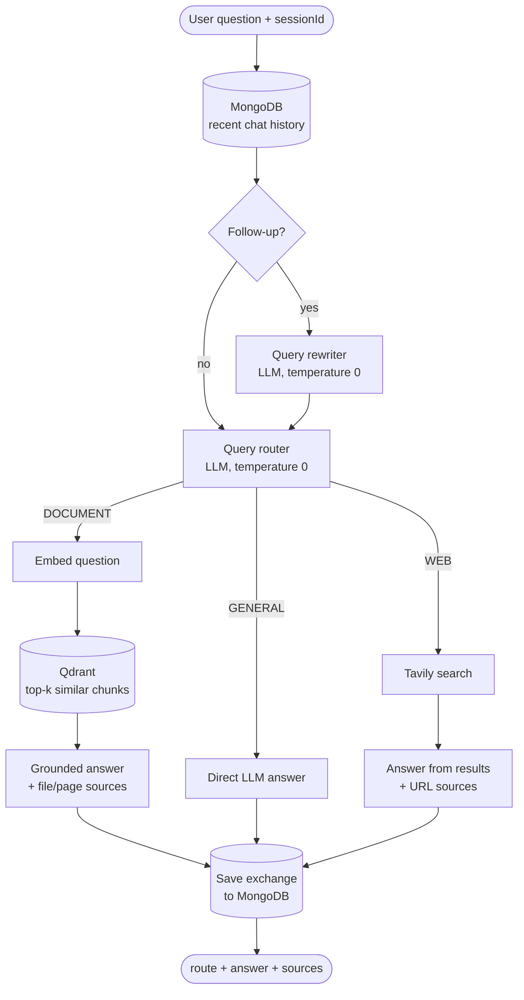
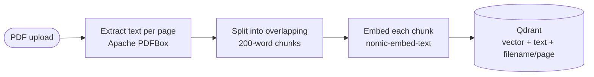

# Adaptive RAG

**A retrieval-augmented question-answering system that decides *how* to answer before it answers.**

Most RAG demos send every question through a vector search, whether or not the answer is in the
documents. This project classifies each question first and routes it to the source that can
actually answer it: your **documents**, the model's **own knowledge**, or a **live web search**.


-black)


<!-- Add a demo GIF or screenshot here, e.g.  -->

---

## Table of contents

- [Why adaptive RAG?](#why-adaptive-rag)
- [Features](#features)
- [How it works](#how-it-works)
- [Design decisions](#design-decisions)
- [Tech stack](#tech-stack)
- [Getting started](#getting-started)
- [Using the app](#using-the-app)
- [API reference](#api-reference)
- [Configuration](#configuration)
- [Testing and evaluation](#testing-and-evaluation)
- [Project structure](#project-structure)
- [Troubleshooting](#troubleshooting)
- [Limitations and future work](#limitations-and-future-work)
- [License](#license)

---

## Why adaptive RAG?

A basic RAG pipeline has one fixed path: *embed the question → search the vector DB → answer from
the retrieved chunks*. That breaks down in two directions:

| Question | Basic RAG | Adaptive RAG |
|---|---|---|
| "What does my resume say about Kafka?" | ✅ Answers from the document | ✅ **DOCUMENT** route |
| "Explain how a hash map works" | ❌ Wasted vector search, then "not in the documents" | ✅ **GENERAL** route, answered directly |
| "What's the weather in Jaipur today?" | ❌ Fails, or hallucinates from unrelated chunks | ✅ **WEB** route, answered from live search results |

Routing **before** retrieval means each question only pays for the source it needs, and questions
outside your documents still get a real answer instead of a refusal or a hallucination.

## Features

- **LLM-based query routing** to `DOCUMENT`, `GENERAL` or `WEB`, implemented with the Strategy pattern
- **PDF ingestion**: page-aware text extraction, overlapping chunking and embeddings stored in Qdrant
- **Grounded answers with citations**: document answers cite file and page, web answers cite URLs
- **Live web search** through Tavily, with today's date in the prompt so "latest" means *now*
- **Multi-turn conversations**: chat history in MongoDB, with follow-ups ("who was *their* captain?")
  rewritten into standalone questions before routing and retrieval
- **Runs fully locally and free**: local LLM and embeddings through Ollama, databases in Docker
- **Labelled evaluation suites** for routing and query rewriting, run against the real model
- **Minimal web UI** that shows the chosen route and sources for every answer

## How it works

### Answering a question



1. **Rewrite**: if the session already has history, the LLM turns a follow-up into a standalone
   question ("Who was the captain of *that team*?" becomes "Who was the captain of Argentina's 2022
   World Cup team?"). First questions skip this step.
2. **Route**: the LLM classifies the standalone question as `DOCUMENT`, `GENERAL` or `WEB`.
3. **Handle**: the matching `QueryHandler` gathers context (document chunks, web results or none)
   and generates the answer.
4. **Remember**: the question and answer are saved to MongoDB under the conversation's `sessionId`.

### Ingesting a document



## Design decisions

**Routing with the Strategy pattern, not a framework.**
Each route is a `QueryHandler` implementation. `RagService` receives every handler through Spring's
collection injection and indexes them by route in an `EnumMap`. Adding a new source means adding
one `@Component` class, with no `switch` statement to edit (open/closed principle).

**A small, predictable router.**
The router prompt combines category definitions with *contrasting* few-shot examples (for example
"Who won the 2011 Cricket World Cup?" → `GENERAL` next to "Who won the most recent IPL final?" →
`WEB`). It runs at **temperature 0**, so the same question always gets the same route, which makes
misroutes reproducible and testable. The reply is parsed defensively (case-insensitive, first route
mentioned wins), and anything unparseable falls back to `DOCUMENT`, the safest route because it
refuses rather than guesses.

**Query rewriting for follow-ups.**
A follow-up like "can you explain those in more detail?" can't be routed, embedded or web-searched
on its own. Rewriting it once, at the start, gives every later step a complete question, and the
handlers don't need to know conversations exist. The prompt only resolves explicit references and
leaves standalone questions unchanged, so a new topic doesn't pick up context from an earlier one.

**Chunking: 200 words, 40-word overlap, per page.**
Small chunks keep each vector focused on one topic (for example, the skills section of a CV), and
the overlap keeps text near a boundary intact in at least one chunk. Chunking page by page means
every chunk can cite an exact page.

**Embedding task prefixes.**
`nomic-embed-text` was trained with `search_query:` and `search_document:` prefixes. Adding them to
questions and chunks noticeably improved how clearly the relevant chunk stood out from the rest. The
prefixes are only used for embedding; the LLM never sees them.

**Grounded, injection-aware prompts.**
Document and web answers must come *only* from the supplied context, with a fixed reply when the
answer isn't there. Retrieved text is wrapped in tags and treated as reference material, so
instructions hidden inside a PDF or web page are ignored. If nothing relevant is retrieved, the LLM
isn't called at all.

**Failing safely.**
If web search is unavailable, the WEB route says so instead of falling back to the model's own
knowledge, because WEB questions are exactly the ones it would answer with outdated information.
The UI renders all server content as text (never as HTML) and only links `http(s)` URLs, so
retrieved content can't inject scripts.

## Tech stack

| Layer | Technology |
|---|---|
| Language / framework | Java 21, Spring Boot 4, Spring Web MVC |
| AI orchestration | Spring AI 2 (`ChatClient`, `EmbeddingModel`, `VectorStore`) |
| Chat LLM | Ollama, `llama3.1:8b` (local) |
| Embeddings | Ollama, `nomic-embed-text` (768 dimensions, cosine similarity) |
| Vector database | Qdrant (Docker) |
| Chat history | MongoDB with Spring Data (Docker) |
| Web search | Tavily API |
| PDF parsing | Spring AI PDF reader (Apache PDFBox) |
| Frontend | A single static HTML page with vanilla JavaScript, served by Spring Boot |
| Tests | JUnit 5, AssertJ, Spring Boot Test |

## Getting started

### Prerequisites

| Tool | Notes |
|---|---|
| **JDK 21+** | Tested with Java 25; the project compiles for Java 21 |
| **Maven 3.9+** | Or use your IDE's built-in Maven |
| **Docker** | Docker Desktop, Rancher Desktop or Colima, for Qdrant and MongoDB |
| **Ollama** | Runs the LLM and embedding model locally ([ollama.com](https://ollama.com)) |
| **Tavily API key** | *Optional*, only needed for the WEB route. The free tier is enough ([tavily.com](https://tavily.com)) |

Hardware: the 8B model needs roughly **8 GB of free RAM**. On Apple Silicon, Ollama uses the GPU
through Metal, so answers take a few seconds.

### 1. Clone the repository

```bash
git clone https://github.com/Divs2001/adaptive-rag.git
cd adaptive-rag
```

### 2. Start Ollama and pull the models

```bash
brew install ollama            # macOS; see ollama.com for Linux and Windows
brew services start ollama     # or run `ollama serve` in a separate terminal

ollama pull llama3.1:8b        # chat model, about 4.9 GB
ollama pull nomic-embed-text   # embedding model, about 270 MB

curl http://localhost:11434    # should print "Ollama is running"
```

### 3. Start Qdrant and MongoDB

```bash
docker compose up -d
docker ps                      # both containers should be "Up"
```

| Service | Port | Purpose |
|---|---|---|
| Qdrant | `6333` | REST API and dashboard at http://localhost:6333/dashboard |
| Qdrant | `6334` | gRPC, used by the application |
| MongoDB | `27017` | Chat history (database `adaptive_rag`) |

Data is kept in Docker volumes, so it survives restarts. `docker compose down -v` deletes it.

### 4. (Optional) Set your Tavily API key

The key is read from an environment variable and is never stored in the repository:

```bash
export TAVILY_API_KEY=tvly-your-key-here
```

In IntelliJ, add it under *Run configuration → Environment variables* instead. Without a key, the app
still starts. Only the WEB route is unavailable, and it says so instead of guessing.

### 5. Run the application

```bash
mvn spring-boot:run
```

Then open **http://localhost:8080**. Qdrant creates the `documents` collection automatically on
the first start.

## Using the app

1. Click **Upload PDF** and choose a document. The app reports how many pages and chunks it ingested.
2. Ask a question about it. The answer is tagged **DOCUMENT** and lists file/page sources.
3. Ask something general ("Who won the 2022 FIFA World Cup?"). It's tagged **GENERAL**.
4. Ask a follow-up ("Who was the captain of that team?"). It's rewritten using the conversation.
5. Ask something current ("What's the weather in Jaipur today?"). It's tagged **WEB**, with links.
6. Click **New chat** to start a fresh conversation. Refreshing the page restores the current one.

## API reference

### `POST /rag/query`: ask a question

```bash
curl -X POST localhost:8080/rag/query \
  -H "Content-Type: application/json" \
  -d '{"query": "Who won the 2022 FIFA World Cup?"}'
```

```json
{
  "sessionId": "3f2a9c1e-...",
  "route": "GENERAL",
  "answer": "Argentina won the 2022 FIFA World Cup, beating France on penalties...",
  "sources": []
}
```

Send the returned `sessionId` with the next question to continue the same conversation. Leave it out
to start a new one. Sources contain `title` and `page` for documents, or `title` and `url` for web
results, plus a similarity or relevance `score`.

### `POST /rag/documents/upload`: ingest a PDF

```bash
curl -F "file=@/path/to/document.pdf" localhost:8080/rag/documents/upload
```

```json
{ "filename": "document.pdf", "pages": 3, "chunks": 7 }
```

Only `.pdf` files up to 20 MB are accepted.

### `GET /rag/sessions/{sessionId}/messages`: read a conversation

```bash
curl localhost:8080/rag/sessions/3f2a9c1e-.../messages
```

Returns the conversation's messages, oldest first, each with `role`, `content`, `route` and `timestamp`.

## Configuration

Everything is in [`src/main/resources/application.yml`](src/main/resources/application.yml).

| Property | Default | Meaning |
|---|---|---|
| `spring.ai.ollama.chat.options.model` | `llama3.1:8b` | Chat model used for routing, rewriting and answers |
| `spring.ai.ollama.chat.options.temperature` | `0.2` | Answer randomness (the router and rewriter always use 0) |
| `spring.ai.ollama.embedding.options.model` | `nomic-embed-text` | Embedding model |
| `rag.chunking.chunk-size` / `overlap` | `200` / `40` | Chunk size and overlap, in words |
| `rag.retrieval.top-k` | `6` | Maximum chunks retrieved per question |
| `rag.retrieval.similarity-threshold` | `0.35` | Minimum cosine similarity for a chunk to be used |
| `rag.embedding.query-prefix` / `document-prefix` | `search_query: ` / `search_document: ` | Task prefixes for the embedding model; set empty for models that don't use them |
| `rag.chat-history.max-messages` | `6` | Recent messages used to rewrite follow-ups |
| `rag.web-search.max-results` | `5` | Tavily results per search |

> **Changing the embedding model, the prefixes or the chunking requires re-ingesting your documents**,
> because existing vectors were built with the old settings:
> `curl -X DELETE localhost:6333/collections/documents`, restart the app, then upload the PDFs again.

## Testing and evaluation

```bash
# Fast unit tests: no external services needed
mvn test -Dtest='TextChunkerTest,RouteDecisionTest,QueryRewriterServiceTest'

# Full suite: needs Ollama, Qdrant and MongoDB running
mvn test
```

| Suite | What it checks |
|---|---|
| `TextChunkerTest` | Chunk boundaries, overlap, whitespace handling, invalid configuration |
| `RouteDecisionTest` | Parsing of noisy router replies ("Category: **WEB**.") and the fallback route |
| `QueryRewriterServiceTest` | Cleanup of noisy rewriter replies (labels, quotes, extra lines) |
| `EmbeddingSanityTest` | Embedding dimension (768) and that related sentences score higher than unrelated ones |
| `QueryRouterEvaluationTest` | **Routing accuracy** on a labelled set of questions per route, run against the real local LLM |
| `QueryRewriterEvaluationTest` | Follow-ups gain the missing context, and standalone questions stay free of unrelated context |

The evaluation suites print a PASS/FAIL line for every case and an overall accuracy. Their questions
are deliberately different from the prompts' few-shot examples, so they measure generalisation rather
than memorisation. Every misroute found during development (for example, past sports results
being sent to WEB) became a new regression case.

## Project structure

```
src/main/java/com/adaptiverag
├── AdaptiveRagApplication.java
├── controller/
│   └── RagController.java            REST endpoints
├── model/                            Records and enums: requests, responses, sources, chat messages
├── repository/
│   └── ChatHistoryRepository.java    Spring Data MongoDB repository
└── service/
    ├── RagService.java               Orchestration: rewrite → route → dispatch → save
    ├── QueryRewriterService.java     Follow-up → standalone question
    ├── QueryRouterService.java       LLM classification into DOCUMENT / GENERAL / WEB
    ├── DocumentService.java          PDF ingestion and vector search
    ├── TextChunker.java              Overlapping word-window chunking
    ├── GenerationService.java        Prompts for direct, document-grounded and web-grounded answers
    ├── WebSearchService.java         Tavily API client
    ├── ChatHistoryService.java       Conversation storage and recent-history window
    └── handler/
        ├── QueryHandler.java         Strategy interface
        ├── DocumentQueryHandler.java
        ├── GeneralQueryHandler.java
        └── WebSearchQueryHandler.java
src/main/resources
├── application.yml
└── static/index.html                 Web UI
```

## Troubleshooting

| Symptom | Fix |
|---|---|
| `Connection refused` to `localhost:11434` | Ollama isn't running: `brew services start ollama` |
| `model "llama3.1:8b" not found` | Pull it: `ollama pull llama3.1:8b` |
| `invalid target release: 21` | Maven is using an older JDK. Point `JAVA_HOME` at JDK 21 or newer |
| Startup fails connecting to MongoDB or Qdrant | Start the containers: `docker compose up -d` |
| WEB answers say "Web search is unavailable" | `TAVILY_API_KEY` isn't set, or the key is invalid. Check the startup log |
| `PKIX path building failed` on web search | A corporate proxy is inspecting HTTPS. Import its root certificate into your JDK's trust store with `keytool` |
| Document questions return "couldn't find anything relevant" | Lower `rag.retrieval.similarity-threshold`, or re-ingest after changing embedding settings |
| `ollama pull` fails with "redirect target not allowed … resolves to non-public" | A DNS filter (often a corporate VPN) is blocking IPv6 for the download host. Pull from another network |

## Limitations and future work

This is a local, single-user proof of concept:

- **No authentication, and documents are shared.** Every uploaded PDF is searchable by every user of
  an instance. Don't upload sensitive documents to a shared deployment.
- **Re-uploading a file stores its chunks again.** Deterministic chunk IDs would remove the duplicates.

Ideas for next steps:

- **Hybrid search**: combine vector similarity with keyword (BM25) matching through Qdrant sparse vectors
- **Re-ranking**: retrieve more candidates, then re-order them with a cross-encoder
- **Document registry and filters**: list uploaded files and let a question target a specific document
- **Relevance grading and self-correction**: grade retrieved chunks and fall back to another route when they don't help
- **Streaming responses** with `ChatClient.stream()` and server-sent events
- **Longer-term memory**: summarise older turns instead of only using a recent window
- **Cloud profile**: hosted LLM, embedding and database services for a public demo

## License

Released under the [MIT License](LICENSE).
